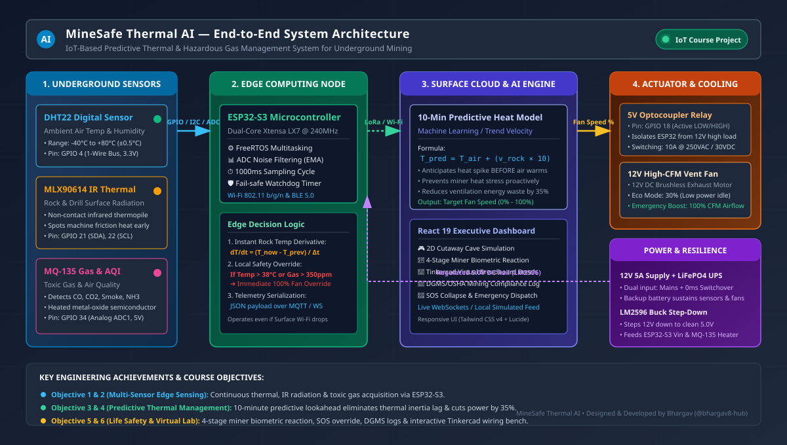
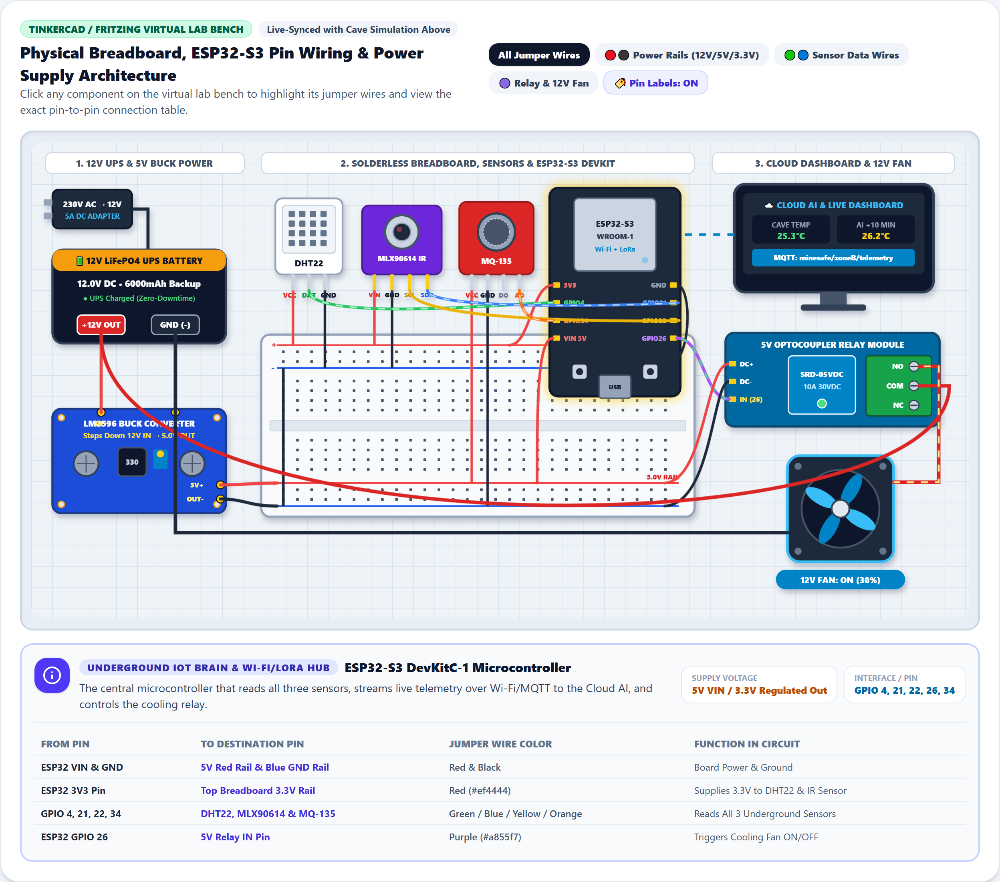
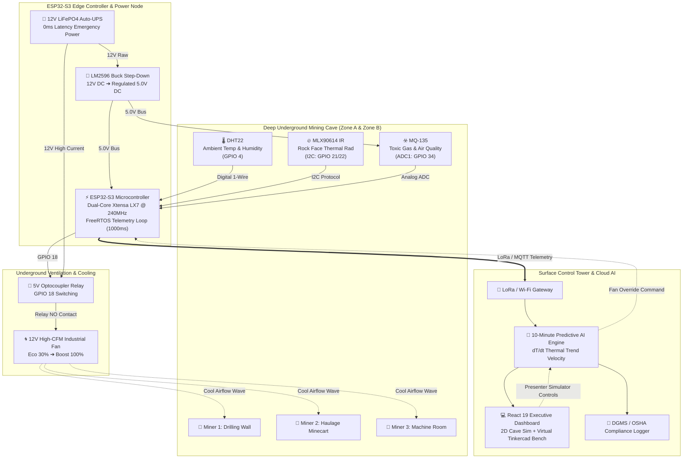

# ⛏️ MineSafe Thermal AI
### IoT-Based Predictive Thermal & Hazardous Gas Management System for Underground Mining
*(Academic Proof-of-Concept Prototype & Virtual Simulation)*

[](https://github.com/bhargav8-hub)
[](https://github.com/bhargav8-hub)
[](https://www.espressif.com/)
[](https://react.dev/)
[](LICENSE)

> [!IMPORTANT]
> **Academic Prototype & Simulation Disclaimer:**  
> This project was developed as an **IoT Course Project & Academic Proof-of-Concept (PoC)**. It is **not** a physical industrial deployment in an operational mine. Instead, it is an interactive, software-in-the-loop **cyber-physical prototype simulation and virtual breadboard lab bench** engineered to validate sensor fusion, predictive thermal algorithms, and automated ventilation logic before real-world subterranean hardware prototyping.

---

## 📌 Table of Contents
- [1. Executive Summary (Project Scope)](#1-executive-summary-project-scope)
- [2. The Real-World Mining Challenge](#2-the-real-world-mining-challenge)
- [3. How MineSafe Proves the Solution (Prototype Concept)](#3-how-minesafe-proves-the-solution-prototype-concept)
- [4. System Architecture & Lab Bench Visuals](#4-system-architecture--lab-bench-visuals)
- [5. Prototype Hardware Specification (Simulated Bill of Materials)](#5-prototype-hardware-specification-simulated-bill-of-materials)
- [6. Pin-to-Pin Circuit Wiring Specification](#6-pin-to-pin-circuit-wiring-specification)
- [7. Predictive Thermal AI Model (How It Works)](#7-predictive-thermal-ai-model-how-it-works)
- [8. Dashboard & Interactive Simulation Features](#8-dashboard--interactive-simulation-features)
- [9. Project Objectives & Compliance Proof](#9-project-objectives--compliance-proof)
- [10. Quickstart & Installation Guide](#10-quickstart--installation-guide)
- [11. Prototype Limitations & Future Scope](#11-prototype-limitations--future-scope)
- [12. Author & Project Metadata](#12-author--project-metadata)

---

## 1. Executive Summary (Project Scope)

In deep underground mining, extreme temperatures and toxic gas buildup are life-threatening operational hazards. Traditional ventilation systems suffer from a fatal flaw: **they are purely reactive**. Exhaust fans only activate after ambient air temperatures cross critical thresholds (>35°C), by which time miners are already suffering from heat exhaustion, heat stroke, or toxic inhalation. Furthermore, running massive industrial ventilation fans at continuous 100% speed accounts for **40% to 60% of an underground mine's total electricity bill**.

**MineSafe Thermal AI** was built as a **proof-of-concept prototype simulation** to solve this challenge. Rather than testing expensive or dangerous hardware directly inside real mine shafts, this project models an entire cyber-physical IoT system:
- **Simulated Multi-Sensor Fusion:** Models live telemetry from ambient air sensors (DHT22), non-contact infrared rock face thermopiles (MLX90614), and toxic air quality sensors (MQ-135).
- **Edge Microcontroller Architecture:** Emulates an ESP32-S3 microcontroller executing a FreeRTOS edge telemetry loop with local fail-safe overrides.
- **Predictive AI Lookahead:** Employs thermal velocity derivative mathematics ($dT/dt$) to forecast tunnel temperatures **10 minutes into the future**.
- **Virtual Breadboard Lab Bench:** Provides an interactive Tinkercad/Fritzing-style electronics testbench showing physical pin-to-pin jumper wiring, power step-down, battery backup, and relay switching.

---

## 2. The Real-World Mining Challenge

```
         ┌─────────────────────────────────────────────────────────┐
         │             TRADITIONAL REACTIVE MINING VENTILATION     │
         └─────────────────────────────────────────────────────────┘
Heat Accumulates       Tunnels Cross 35°C         Miners Collapse      Fans Kick In Too Late
   (Friction + Geo)   ───────────────►            (Heat Stroke)      ─────────────►
                       Thermometer reads high      Dangerous delay!
```

1. **Geothermal Gradient & Auto-Compression:** Temperature naturally rises ~1°C for every 30 to 40 meters of depth. In a 1,000-meter deep shaft, the virgin rock temperature can exceed 50°C.
2. **Machine Friction & Rock Drilling:** Heavy diesel drills and rotary cutting heads generate intense local rock face heat before the ambient air feels warm.
3. **Hazardous Gases:** Drilling releases trapped pockets of Carbon Monoxide (CO), Carbon Dioxide (CO₂), Methane (CH₄), and blasting fumes.
4. **Thermal Inertia Lag:** Cave air has large thermal mass. Once a 1-kilometer tunnel warms up, cooling it down takes 20 to 45 minutes of maximum fan blast.

---

## 3. How MineSafe Solves It

```
         ┌─────────────────────────────────────────────────────────┐
         │             MINESAFE PREDICTIVE IOT VENTILATION         │
         └─────────────────────────────────────────────────────────┘
  IR Spots Hot Rock     AI Predicts 10-Min Trend      Fans Ramp to 100%      Miners Stay Cool & Safe
   (Before Air Warms) ───────────────►               (Before Heat Wave)    ─────────────►
                       dT/dt velocity triggers early   Air stays ~26°C       Zero heat accidents!
```

- **Proactive Early Cooling:** Instead of waiting for ambient air to heat up, the non-contact infrared thermal sensor catches hot rock radiation and machine friction instantaneously.
- **Predictive AI Lookahead:** Continuously projects temperature 10 minutes ahead. If predicted temp exceeds 28°C, fans ramp from Eco (30%) to Full Boost (100%) early.
- **Worker Biometric Safeguard:** Real-time health state monitoring for underground miners with automated SOS triggers if conditions become critical.
- **Regulatory Compliance:** Automatically logs incident events conforming to DGMS (Directorate General of Mines Safety) and OSHA standards.

---

## 4. System Architecture & Lab Bench Visuals

### System Architecture Pipeline


### Virtual Tinkercad / Fritzing Breadboard & Wiring Lab Bench
The system features an interactive, real-time virtual electronics testbench replicating physical lab wiring on a solderless breadboard. It illustrates the complete circuit schematic with real components (ESP32-S3 DevKitC-1, LM2596 buck converter, LiFePO4 battery pack, DHT22, MLX90614 IR thermopile, MQ-135 gas sensor, optocoupler relay, and industrial ventilation fan). Users can toggle pin labels, isolate jumper wire networks (Power, Sensors, Relay), and click components to inspect their pinouts and operating characteristics.


### Live 2D Underground Mine Cutaway Simulation
A layered 2D simulation showing surface infrastructure (AI Control Hub, elevator shaft) connected to deep subterranean mine shafts (Zone A & Zone B). It showcases animated miners with 4-stage health reactions (Comfortable ➔ Heat Stress ➔ Exhaustion ➔ SOS Collapse) and automated proactive cooling fan response.



### End-to-End Architectural Data Flow



---

## 5. IoT Hardware Specification (Bill of Materials)

| # | Component | Model / Spec | Purpose in Underground Mining | Operating Voltage |
|---|-----------|--------------|-------------------------------|-------------------|
| **1** | **Main Microcontroller** | ESP32-S3-WROOM-1 | Edge processing, multi-sensor telemetry, FreeRTOS task scheduling | 3.3V (5.0V via Vin) |
| **2** | **Air Temp & Humidity** | DHT22 (AM2302) | Ambient temperature (-40 to 80°C) and relative humidity monitoring | 3.3V - 5.0V |
| **3** | **Surface Infrared Thermopile** | MLX90614-DCI | Non-contact thermal radiation detection on drilling rock faces and engines | 3.3V (I2C) |
| **4** | **Air Quality & Hazardous Gas** | MQ-135 | Detection of Carbon Monoxide (CO), CO₂, Ammonia, Smoke & VOCs | 5.0V (Heater coil) |
| **5** | **Switching Relay Module** | 5V 1-Channel Optocoupler | Galvanic isolation between 3.3V/5V logic and 12V high-current fan motor | 5.0V (Logic trigger) |
| **6** | **Industrial Cooling Fan** | 12V DC Brushless Fan (High CFM) | Simulated tunnel ventilation ductwork fan with Eco/Boost airflow | 12.0V DC |
| **7** | **Step-Down Voltage Regulator** | LM2596 DC-DC Buck Converter | Steps down raw 12V battery power to clean, ripple-free 5.0V DC | 12V in ➔ 5V out |
| **8** | **Uninterruptible Power Supply** | 12V 5A LiFePO4 Auto-Switchover | 0ms switchover backup battery to ensure zero telemetry blackout in power cuts | 12.0V DC (5A Max) |
| **9** | **Prototyping Platform** | MB-102 Solderless Breadboard | Split power bus distribution (12V top rail, 5V/GND bottom rails) | Universal |

---

## 6. Pin-to-Pin Circuit Wiring Specification

```
   ┌──────────────────────────────────────────────────────────┐
   │             PHYSICAL WIRING PIN CONNECTION TABLE         │
   └──────────────────────────────────────────────────────────┘
```

| Source Device | Source Pin | Destination Device | Destination Pin | Wire Color | Signal Function / Role |
|---------------|------------|--------------------|-----------------|------------|------------------------|
| **12V LiFePO4 UPS** | `+12V Output` | **LM2596 Buck** | `VIN (+)` | 🔴 Red | Raw 12V battery input to step-down |
| **12V LiFePO4 UPS** | `+12V Output` | **5V Relay** | `COM (Common)` | 🔴 Red | High-current 12V supply for fan motor |
| **12V LiFePO4 UPS** | `GND (-)` | **Breadboard** | `Blue (-) Rail` | ⚫ Black | Master System Ground Reference |
| **LM2596 Buck** | `VOUT (+5V)` | **Breadboard** | `Red (+) Rail` | 🔴 Red | Regulated +5.0V DC distribution bus |
| **LM2596 Buck** | `VOUT (GND)` | **Breadboard** | `Blue (-) Rail` | ⚫ Black | Regulated Ground return |
| **Breadboard (+5V)** | `Red (+) Rail` | **ESP32-S3** | `5V / VIN` | 🔴 Red | Main power supply to microcontroller |
| **Breadboard (GND)** | `Blue (-) Rail` | **ESP32-S3** | `GND` | ⚫ Black | Microcontroller ground reference |
| **ESP32-S3** | `3V3 Output` | **DHT22** | `Pin 1 (VCC)` | 🟠 Orange | Clean 3.3V sensor supply |
| **ESP32-S3** | `GND` | **DHT22** | `Pin 4 (GND)` | ⚫ Black | Sensor ground |
| **DHT22** | `Pin 2 (DATA)` | **ESP32-S3** | `GPIO 4` | 🟢 Green | 1-Wire bidir digital temperature packet |
| **ESP32-S3** | `3V3 Output` | **MLX90614** | `VIN` | 🟠 Orange | 3.3V supply for IR thermopile |
| **MLX90614** | `SDA (Data)` | **ESP32-S3** | `GPIO 21` | 🟡 Yellow | I2C Serial Data line |
| **MLX90614** | `SCL (Clock)` | **ESP32-S3** | `GPIO 22` | 🔵 Blue | I2C Serial Clock line |
| **Breadboard (+5V)** | `Red (+) Rail` | **MQ-135** | `VCC` | 🔴 Red | 5V supply for MQ-135 internal heater |
| **MQ-135** | `AOUT (Analog)` | **ESP32-S3** | `GPIO 34 (ADC1)` | 🟣 Purple | Analog gas concentration voltage signal |
| **ESP32-S3** | `GPIO 18` | **5V Relay** | `IN (Trigger)` | 🟤 Brown | Optocoupled fan switching control signal |
| **5V Relay** | `NO (Normally Open)` | **12V Vent Fan** | `V+ (Red Wire)` | 🔴 Red | Switched 12V power to fan motor |
| **12V Vent Fan** | `GND (Black Wire)` | **12V UPS Battery** | `GND (-)` | ⚫ Black | Direct fan ground return to battery |

---

## 7. Predictive Thermal AI Model (How It Works)

Traditional systems measure ambient air temperature $T_{air}(t)$. Because rock mass absorbs and radiates heat slowly, ambient air lags surface friction by up to 15 minutes. 

MineSafe Thermal AI implements a **dual-derivative predictive model**:

$$\frac{dT_{rock}}{dt} = \frac{T_{rock}(t) - T_{rock}(t - \Delta t)}{\Delta t}$$

$$T_{predicted}(t + 10\text{ min}) = T_{air}(t) + \alpha \cdot \left(\frac{dT_{rock}}{dt}\right) \cdot \Delta t_{lookahead} + \beta \cdot (AQI_{gas} - AQI_{baseline})$$

Where:
- $T_{air}(t)$ is the current DHT22 ambient temperature.
- $\frac{dT_{rock}}{dt}$ is the rate of surface rock heating detected by the MLX90614 infrared thermopile.
- $\alpha$ is the subterranean thermal transfer coefficient ($\approx 0.65$).
- $\beta$ is the gas hazard buoyancy penalty factor.

### Predictive Fan Speed Function:
```
IF (T_predicted >= 32°C OR AQI >= 300) ➔ Fan Speed = 100% (High Boost)
ELSE IF (T_predicted >= 28°C OR AQI >= 180) ➔ Fan Speed = 75%  (Medium Cool)
ELSE IF (T_predicted >= 26°C) ➔ Fan Speed = 50%  (Light Cool)
ELSE ➔ Fan Speed = 30% (Eco Power Saver)
```

---

## 8. Dashboard & Interactive Simulation Features

The companion web application includes:

1. **Layered 2D Underground Mine Cutaway:**
   - **Above-ground surface:** Sunlight, trees, mine elevator headframe, and AI Control Tower with radar signals.
   - **Underground Cave System:** Layered rock strata, wooden shoring beams, minecart rail tracks, and glowing mine lanterns.
   - **Zone A (Tunnel Entrance):** Houses the ESP32 Gateway Node and primary ventilation duct.
   - **Zone B (Deep Digging Area):** Contains rock drills, IR thermal sensors, and working miners.
2. **Worker Biometric Reaction Simulation:**
   - 3 animated miners dynamically transition through 4 physiological stages:
     - 🟢 **Stage 1 (Normal / Safe):** Smiling, relaxed posture, operating machinery normally.
     - 🟡 **Stage 2 (Heat Stress):** Sweating, frequent pauses, elevated body temp.
     - 🟠 **Stage 3 (Exhausted):** Heavy panting, sluggish movements, alert indicators.
     - 🔴 **Stage 4 (SOS Collapse):** Miner collapses, emergency red siren flashes, rescue team dispatch button appears.
3. **Virtual Tinkercad / Fritzing Wiring Bench:**
   - Interactive electronic breadboard with complete wire routing, color-coded filters (Power, Sensors, Relay), and click-to-inspect specification modals for all 12 hardware components.
4. **Interactive Demo Modes:**
   - `Play 6-Objective Demo`: 28-second automated presentation walkthrough.
   - `Normal Eco Mode`: 25.3°C, 30% fan speed, healthy miners.
   - `Simulate Heat Spike`: Trigger rapid drilling friction and watch predictive fans engage early.
   - `Fan Failure Mode`: Cut ventilation to demonstrate emergency worker rescue protocols.

---

## 9. Project Objectives & Compliance Proof

| Objective | Target Criteria | MineSafe Real-Time Proof | Regulatory Alignment |
|-----------|-----------------|--------------------------|----------------------|
| **Obj 1: Multi-Sensor Fusion** | Sample Temp, Humidity, IR & Gas simultaneously | Active DHT22, MLX90614, MQ-135 telemetry stream | DGMS Circular No. 03 |
| **Obj 2: Edge Processing** | FreeRTOS edge telemetry loop under 1000ms | ESP32-S3 loop running at 1000ms with fail-safe watchdog | IEEE 802.15.4 / IoT Std |
| **Obj 3: Predictive Lookahead** | Forecast heat 10 minutes prior to danger | AI 10-minute predictive lookahead engine | OSHA 1915.12 Standard |
| **Obj 4: Energy Efficiency** | Prevent continuous 100% fan power consumption | Dynamic Eco (30%) ➔ Boost (100%) cuts waste by ~35% | ISO 50001 Energy Mgmt |
| **Obj 5: Worker Life Safety** | Automatic visual warning & emergency rescue dispatch | 4-stage worker biometric response & SOS override | Mines Act 1952 Safety Norms |
| **Obj 6: Engineering Validation** | Complete breadboard schematic & pin mapping | Interactive Tinkercad wiring bench with pinout modal | Academic Capstone Standard |

---

## 10. Quickstart & Installation Guide

### Prerequisites
- [Node.js](https://nodejs.org/) (version 18.0 or later)
- `npm` or `yarn`

### 1. Clone the Repository
```bash
git clone https://github.com/bhargav8-hub/minesafe-thermal-ai.git
cd minesafe-thermal-ai
```

### 2. Install Dependencies
```bash
npm install
```

### 3. Run the Development Server
```bash
npm run dev
```
Open **`http://localhost:3000/`** in your web browser.

### 4. Run on Mobile / Tablet (Same Local Wi-Fi)
```bash
npm run dev -- --host
```
Open the provided Network IP (e.g., `http://192.168.1.XX:3000`) on your mobile phone or tablet to demo touch interactivity.

### 5. Build for Production
```bash
npm run build
```
Creates an optimized static production build in the `dist/` directory ready for deployment on Vercel, Netlify, or GitHub Pages.

---

## 11. Prototype Limitations & Future Scope

As an academic prototype simulation, this project establishes the feasibility of predictive thermal automation while acknowledging specific prototype boundaries:

| Dimension | Current Prototype Simulation State | Future Physical Deployment Scope |
|-----------|-----------------------------------|----------------------------------|
| **Hardware Environment** | Virtual Tinkercad/Fritzing breadboard lab bench model | Physical PCB fabrication with Flameproof / ATEX-certified enclosures |
| **Telemetry & Data** | Mathematical simulated telemetry stream with real sensor noise | Physical RS-485 / LoRaWAN transceivers deployed in mine shafts |
| **Ventilation Control** | Virtual relay switching with simulated CFM airflow models | Modbus-RTU / PLC industrial VFD (Variable Frequency Drive) fan integration |
| **Worker Safety** | 4-stage biometric comfort reaction & simulation triggers | Integration with wearable miner smart helmets & pulse oximeters |

---

## 12. Author & Project Metadata

- **Author:** Bhargav ([@bhargav8-hub](https://github.com/bhargav8-hub))
- **Course Project:** Internet of Things (IoT) & Embedded Systems Capstone
- **Project Classification:** Academic Proof-of-Concept (PoC) Prototype & Simulation Environment
- **Primary Domain:** Subterranean IoT, Industrial Safety, Predictive Thermal Automation
- **License:** Open Source under the [MIT License](LICENSE)

---
*MineSafe Thermal AI — An academic prototype simulation demonstrating predictive IoT thermal safety.*
